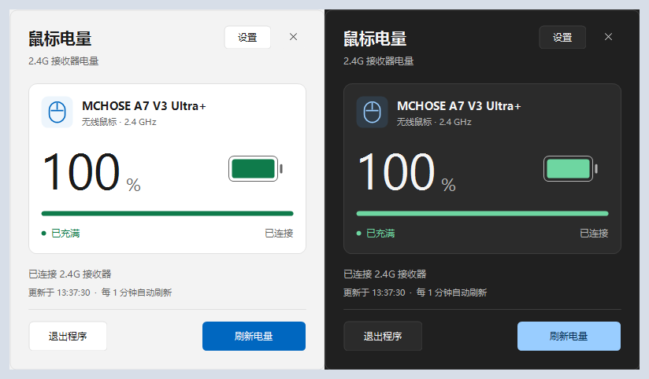
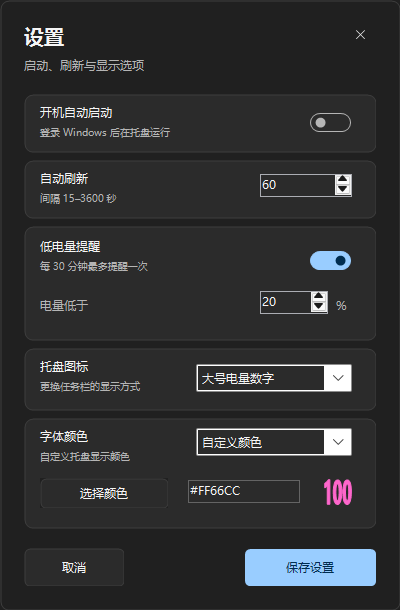

# 2.4G 鼠标电量显示

一个 Windows 托盘工具，用来查看 **MCHOSE A7 V3 Ultra+** 在 2.4G 模式下的电量。

程序通过 USB HID 与接收器通信，默认每分钟读取一次电量。任务栏图标可以显示电量数字或电池，点击后查看充电状态、更新时间和设置，无需让 M HUB 常驻。

目前只适配 MCHOSE A7 V3 Ultra+ 的 `VID_3837 / PID_1018` 接收器，其他型号、蓝牙模式和有线模式尚未适配。这是一个非官方工具，与 MCHOSE 无隶属关系。



## 使用

运行环境为 Windows 11，需要系统中的 .NET Framework 4.8 或更高的 4.x 版本。程序使用 C# / WinForms 编写，无需安装 .NET 6/8 或 Python。

1. 将 `2.4GBattery.exe` 放在固定目录，连接鼠标的 2.4G 接收器。
2. 双击运行。程序启动后位于任务栏通知区域，不显示普通主窗口。
3. 如果找不到图标，展开任务栏右侧的隐藏图标区域，将它拖到任务栏上。

| 操作 | 功能 |
| --- | --- |
| 左键点击托盘图标 | 刷新电量并打开详情面板 |
| 悬停托盘图标 | 查看电量、充电状态和更新时间 |
| 右键点击托盘图标 | 打开菜单，可进入设置或退出程序 |
| 详情页按 `F5` / `Enter` | 刷新电量；`Enter` 在按钮获得焦点时也会执行该按钮 |
| 按 `Tab` | 切换控件焦点 |
| 按 `Esc` | 收起详情面板；在设置页则取消编辑并返回详情 |

普通模式下，面板失去焦点后会自动收起。需要保持面板打开时，可以在 PowerShell 中运行：

```powershell
.\2.4GBattery.exe --show
```

关闭面板只会收起窗口，退出程序请使用「退出程序」按钮或托盘菜单。程序只允许运行一个实例，重复启动不会打开第二个窗口。

## 设置

点击详情面板右上角的「设置」，或从托盘右键菜单进入。修改后点击「保存设置」立即生效；取消编辑不会改变已保存的设置。

| 选项 | 默认值 | 说明 |
| --- | --- | --- |
| 开机自动启动 | 关闭 | 当前用户登录 Windows 后启动 |
| 自动刷新 | 60 秒 | 可设为 15–3600 秒 |
| 低电量提醒 | 开启，阈值 20% | 电量低于阈值时提醒，可设为 1–99%；运行期间每 30 分钟最多提醒一次 |
| 托盘图标 | 大号电量数字 | 可切换为简约电池 |
| 字体颜色 | 随电量变化 | 可改为跟随任务栏深浅色，或自定义颜色 |

按电量变色时，50% 及以上为绿色，20–49% 为黄色，低于 20% 为红色。提醒阈值和这些颜色分段相互独立。未连接或电量未知时，数字显示为 `--`。

自定义颜色支持选色器和六位十六进制输入，如 `#FFFFFF`。设置页右侧显示预览，颜色同时适用于数字和电池图标。使用 Windows 高对比度模式时，优先使用系统颜色。

详情页和设置页跟随 Windows 的应用深浅色设置，托盘图标跟随任务栏的深浅色设置。



配置保存在 `%APPDATA%\MCHOSEBattery\config.ini`。开机启动项位于：

```text
HKEY_CURRENT_USER\Software\Microsoft\Windows\CurrentVersion\Run
  MCHOSEBattery = "程序的完整路径"
```

移动程序后，需要重新关闭再开启「开机自动启动」，以更新路径。删除程序前也应先关闭此项。

## 编译

构建脚本使用 Windows 自带的 .NET Framework C# 编译器，不需要 Visual Studio 或 NuGet 包。在项目目录打开 PowerShell：

```powershell
.\build.ps1
```

如果 PowerShell 阻止执行脚本，可仅对这一次构建使用：

```powershell
powershell -NoProfile -ExecutionPolicy Bypass -File .\build.ps1
```

编译结果为项目根目录的 `2.4GBattery.exe`。重新编译前请先退出正在运行的程序，否则文件会被占用。构建脚本优先查找 `Framework64` 下的 `csc.exe`，找不到时使用 `Framework` 下的编译器。

源码按以下方式划分：

```text
src/
  Main.cs           入口、单实例和 DPI 初始化
  App.cs            托盘、轮询、提醒和开机启动
  Battery.cs        接收器枚举与 HID 通信
  Icon.cs           托盘数字和电池图标绘制
  DetailForm.cs     电量详情窗口
  Settings.cs       配置解析与保存
  SettingsPanel.cs  设置界面和编辑状态
  UiTheme.cs        主题、绘图控件和 Windows 窗口效果
build.ps1           构建脚本
docs/images/        README 使用的界面截图
```

## 设备通信

这款接收器的电量读取使用厂商私有 HID 报文。当前实现参考 M HUB 的通信记录，读取设备信息后解析电量和充电状态，不发送修改鼠标设置的命令。

| 字段 | 当前实现 |
| --- | --- |
| USB 设备 | `VID_3837 / PID_1018` |
| HID 接口路径 | 包含 `mi_02` 和 `col02` |
| Report ID | `0x4D`，通过 output / input report 通信 |
| 请求 | `4D 01 01 00 00 09 00 00 08`，其余字节补零，总计 65 字节 |
| 响应校验 | 前三个字节为 `4D 01 01`，长度至少 24 字节 |
| 电量 | 响应 `buf[20]`，范围 0–100；超出范围按未知处理 |
| 充电状态 | 响应 `buf[21]`；高四位非零或低四位为 4 时显示已充满，低四位为 3 时显示充电中 |

这里的下标从 0 开始，包含 Report ID。协议解析只对应当前设备，不能直接用于其他型号。适配新设备时，需要确认设备标识、HID 接口、报文格式和字段位置。

## 常见问题

**显示「未检测到 2.4G 接收器」**

检查是否使用了受支持型号的接收器，以及接收器是否正常连接。仅有蓝牙连接时无法读取。

**显示「设备无响应」或电量没有更新**

先移动鼠标或点击按键将其唤醒，再手动刷新。仍然失败时，关闭可能占用设备的驱动程序后重试，也可以重新插拔接收器。电量由设备上报，程序按设定间隔轮询。

**数字在任务栏上不够清楚**

在设置中使用与背景对比明显的自定义颜色，例如深色任务栏配白色。任务栏图标区域大小由 Windows 决定，三位数字会压缩宽度以容纳 `100`。

反馈问题时，请附上鼠标型号、接收器 VID/PID、Windows 版本、界面提示，以及唤醒鼠标后是否能恢复读取。
